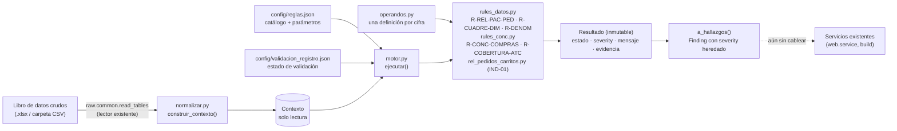

# Motor de reglas de negocio (Fase 2A)

Especificación: `docs/fase1/ESPECIFICACION_FASE1_REPORT_INTELLIGENCE_FINAL.md` (§3.3, §3.5, §8.2). Configuración: `docs/CONFIGURACION_FASE1.md`. Modelo de hallazgos: `docs/MODELO_HALLAZGOS.md`.

**Estado: implementado y probado en lo básico (Fase 2A). Las pruebas exhaustivas, la validación de resultados y la comprobación de regresiones completa son la Fase 2B. Ningún servicio existente consume todavía el motor: los flags de `reglas.json` siguen desactivados y no se modificó ningún flujo de generación de reportes.**

## 1. Arquitectura



| Capa | Archivo | Responsabilidad |
|---|---|---|
| Lectura | `raw/common.py` (existente) | Lee hojas y normaliza encabezados. No se duplicó |
| Normalización | `validator/normalizar.py` | Construye el `Contexto`: líneas de `ventas`, catálogo, tráfico a nivel sitio y columnas realmente presentes. No filtra ni corrige |
| Motor | `validator/motor.py` | Lee el catálogo, decide aplicabilidad y columnas, ejecuta, normaliza estados, convierte a `Finding` |
| Cifras compartidas | `validator/operandos.py` | Pedidos del sistema de ventas, compras GA4, carritos agregados, monto y razones (F-01, F-02, F-03, F-11). Una sola definición |
| Reglas | `validator/rules_datos.py`, `validator/rules_conc.py`, `validator/rel_pedidos_carritos.py` | Una función por regla; solo calculan |
| Resultados y evidencias | `motor.Resultado` | Inmutable, reproducible, con evidencia y `faltante` |
| Configuración | `config/reglas.json` (catálogo `reglas`) | Id, nombre, descripción, versión, unidades, columnas requeridas, parámetros, activación, severidad, mensajes, evidencia |

Las reglas **no modifican los datos de origen**: reciben el `Contexto` y devuelven `Resultado`s. Las reglas no se llaman entre sí; las cifras comunes viven en `operandos.py`, de modo que una regla no puede alterar en silencio el cálculo de otra.

Las reglas nuevas están en módulos nuevos; `validator/rules.py` (validaciones históricas) **no se modificó**.

## 2. Estados

| Estado | Significado | `severity` heredado |
|---|---|---|
| `valid` | Validación satisfactoria | `info` (no genera hallazgo) |
| `warning` | Advertencia: hay algo que interpretar con cuidado | `warn` (o `info` para limitaciones informativas, por regla) |
| `error` | Incumplimiento de una condición que requiere atención | `warn` — **ninguna regla bloquea** (`block` no se emite) |
| `not_verifiable` | Falta información; siempre trae `faltante` | `info` |
| `not_applicable` | La regla no corresponde a la unidad | `info` |
| `not_validated_with_real_data` | La regla está implementada pero sin validación operacional. Se expone en `Resultado.estado_validacion` (leído de `validacion_registro.json`); no es un desenlace, es una etiqueta que acompaña a todo resultado hasta que exista confirmación | — |

Advertencia ≠ error, y falta de datos ≠ incumplimiento. La severidad por estado y las excepciones por código están en `reglas.json` (`severidad`, `severidad_codigos`). `Resultado.a_hallazgo()` produce un `Finding` con `severity` heredado y, además, `regla_id`, `regla_version`, `tipo`, `estado_verificacion`, `faltante`. `gravedad` queda `None` (no está definida en la especificación; no se inventa).

## 3. Reglas

Todas son de solo lectura y se ejecutan con `motor.ejecutar(ctx)`. Aplicabilidad por unidad según la especificación §3.6.

### R-REL-PAC-PED (GLP-1 y AETOPS)
Opera sobre `id_pedido` e `id_paciente` distintos, nunca sobre filas. Por `id_pedido`: fechas distintas, pacientes distintos. **C2** (más de una fecha): fuera del universo; **E** elegible; sobre `E` con fecha en el periodo: **A** (1…m pacientes), **B** (ninguno), **C** (más de `max_pacientes_por_pedido`). Calcula pacientes únicos, cobertura de paciente y razón de recurrencia; verifica las identidades de control. Informa duplicados exactos y líneas repetidas sin eliminarlos.
- **No existe estatus de pedido**: `estado` es la entidad federativa. C0 y C1 están reservadas e inactivas (`clases_reservadas_inactivas` en la evidencia); si se configura `estatus_excluidos`, se emite `estatus_no_disponible` y se ignora. No se declaran cancelaciones ni devoluciones.
- Resultados: `relacion_paciente_pedido` (`valid`/`error`/`not_verifiable`), `paciente_contradictorio`, `fecha_contradictoria`, `lineas_sin_id_pedido` (`error`), `duplicado_exacto`, `linea_duplicada` (`warning` informativo), `cobertura_paciente`, `identidad_control` (`error` interno).

### R-CUADRE-DIM (GLP-1 y AETOPS)
Para cada dimensión candidata (config: GLP-1 canal, estado, región, categoría, SKU; AETOPS canal, estado, sucursal, línea, categoría, SKU) y cada entidad (pedido, paciente) cuenta cuántas entidades aparecen en más de un valor y la suma de subtotales frente al total de entidades distintas.
- **Observado, no declarado:** si alguna entidad aparece en más de un valor ⇒ `warning` «no exclusiva: no sumar sus subtotales como universos independientes». Si no se observa solapamiento ⇒ `not_verifiable` (la ausencia de contraejemplo no demuestra exclusividad; falta declarar la propiedad).
- **Declarado y justificado** (`reglas.json` → `dimensiones`): se aplica la tabla de cuatro combinaciones (SÍ/SÍ `suma = total`; SÍ/NO `suma ≤ total`; NO/SÍ `suma ≥ total`; NO/NO sin relación exigible) con `tolerancia_conteo`. «Sin asignar» es una categoría **virtual** solo para dimensiones declaradas exhaustivas.
- Nunca filtra ni elimina registros.

### R-CONC-COMPRAS (solo GLP-1)
Compara, en el mismo periodo y a nivel sitio, **pedidos del sistema de ventas** (`ventas.id_pedido`) con **compras GA4** (`trafico.compras`). Cada cifra nombra su fuente. `brecha = (compras − pedidos) / pedidos` (F-03). Si `|brecha| > umbral` (heredado 20 %, mismo criterio que el aviso existente `TRAFICO_PURCHASE_DIFFERS`, que **no se modificó**) ⇒ `warning` con texto «diferencia entre fuentes distintas, no un error confirmado» y causas posibles como hipótesis a validar. En AETOPS: `not_applicable` («No aplica: la unidad AETOPS no tiene hoja `trafico`»). Faltantes ⇒ `not_verifiable`; nunca se completa con la otra fuente.

### R-DENOM
Función reutilizable `motor.evaluar_razon()` y regla que la aplica a las razones que la unidad puede calcular (`operandos.razones`): ticket (F-11), IND-01 por fuente (F-01, F-02) y la brecha (F-03; GLP-1). Valida numerador y denominador existentes, denominador cero (⇒ `not_verifiable`, **nunca 0 %**), negativo (⇒ `error`; la brecha admite numerador con signo), periodos, granularidades y combinaciones de fuentes distintos (⇒ `warning` con el valor calculado y la limitación). Cada resultado identifica numerador, denominador, fuentes y periodo.

### R-COBERTURA-ATC e IND-01 (solo GLP-1)
`Relación pedidos/carritos = (pedidos / carritos agregados) × 100`, con carritos = Σ `trafico.add_to_cart` **a nivel sitio** (`vista = general`, `sku` vacío; los desgloses no se usan). La fuente de pedidos es configurable (`fuente_pedidos`: `sistema_ventas`, `ga4_compras` o sin configurar). Sin configurar, **se emiten dos resultados independientes**: relación con pedidos del sistema de ventas y relación con compras GA4.
- La unidad de los carritos sale de `unidad_carritos` (por defecto «unidad no declarada»); con unidad no declarada el cálculo se permite y el resultado es `warning` informativo («interpretación limitada»). Un resultado `valid` exige unidad declarada y ninguna otra limitación.
- Si supera 100 % ⇒ `warning` (`severity = warn`), valor conservado, texto de cautela sin causa afirmada.
- Falta de dato o carritos = 0 ⇒ `not_verifiable`, sin valor (no 0 %).
- No se calcula el complemento, no se llama abandono y no se usan identificadores de carrito, de transacción ni de sesión.

## 4. Interpretaciones adoptadas (donde la especificación no fija el detalle)
1. **Pedidos del sistema de ventas** se definen con los **mismos criterios que el motor actual** (`raw/glp1.build`): fecha legible, importe y piezas numéricos, `id_pedido`/`id_paciente`/`sku` no vacíos y SKU en el catálogo. Así `R-CONC-COMPRAS` coincide con el aviso existente.
2. **`calculable` de IND-01 exige unidad declarada** (la especificación la lista como condición); con los machotes, que no la declaran, todo resultado nace como `warning` informativo.
3. **Pedidos sin fecha legible** (clase `sin_fecha`): no están en la especificación; se cuentan aparte para que la identidad `|id_pedido del archivo| = C0+C1+C2+sin_fecha+E` siga cerrando. El contrato ya bloquea fechas ilegibles al generar.
4. **`R-CUADRE-DIM` sin declaración**: se reporta lo observado (ver §3) en lugar de no hacer nada, porque la tarea pide detectar solapamientos; las propiedades declaradas conservan su tratamiento de la especificación.
5. **`tipo` de cada regla** (consistencia, consistencia, conciliación, integridad, cobertura) es una clasificación propuesta en el catálogo; `gravedad` queda en `null`.
6. **`validacion_registro.json` no cambió**: las reglas aparecen con `regla_version: null` hasta que la validación sintética de la Fase 2B las apruebe; la versión de cada regla vive en `reglas.json` (`1.0.0`).
7. Los **flags** de `reglas.json` siguen en `false`: el motor se puede invocar, pero los servicios existentes todavía no lo hacen.

## 5. Uso
```python
from backend.app.models import Period
from backend.app.validator.normalizar import construir_contexto
from backend.app.validator import motor

ctx = construir_contexto("data/ejemplos/GLP1_crudo_ejemplo.xlsx", Period("GLP1", "mensual", 2026, 9))
resultados = motor.ejecutar(ctx)                  # list[Resultado]; ids=[...] para elegir reglas; overrides={...} solo para pruebas
hallazgos = motor.a_hallazgos(resultados)         # list[Finding] (severity heredado; sin los valid)
```
```bash
python -m backend.app.validator.motor data/ejemplos/GLP1_crudo_ejemplo.xlsx --unidad glp1 --periodo 2026-9
```

## 6. Lo que este bloque NO hace
No modifica pipeline, importadores, narrativa, IA, plantillas, láminas, fórmulas ni cifras; no cambia `has_blockers()`, `severity` ni el aviso `TRAFICO_PURCHASE_DIFFERS`; no implementa E1/E2 parametrizados, el anexo de calidad, QA, anonimización ni procedencia completa; no escribe en el historial; no envía datos fuera del navegador.

## 6.1 Ajustes de la Fase 2B (defectos corregidos tras la auditoría)
- Sin pedidos válidos en el periodo, «pedidos del sistema de ventas» es un **faltante** (no un cero): ninguna razón muestra 0 % por falta de datos.
- `R-CUADRE-DIM` analiza cada entidad con sus propias líneas (una línea sin paciente sigue contando para el pedido).
- `Resultado.verificacion` permite marcar `verificado` a los avisos aritméticos (R-CONC-COMPRAS, duplicados, solapamiento observado), conforme a la especificación.
- `motor.ejecutar(ids=[…])` rechaza reglas inexistentes; `normalizar.construir_contexto` lanza `ErrorLectura` con un mensaje comprensible si el archivo no existe o no es legible.
- La evidencia de `R-REL-PAC-PED` incluye `no_asignables`, `tasa_no_asignables` (F-06) y `pedidos_universo_motor`.
Detalle en `docs/fase1/implementacion/F2B_INFORME_AUDITORIA.md`.

## 7. Dependencias para la Fase 2B (histórico de la 2A)
Pruebas exhaustivas T-01…T-05, T-10, T-21 y T-22 con las fixtures funcionales (`tools/make_fixtures_fase1.py` aún solo cubre modelo y catálogo); decidir el cableado (flag `validacion_fase1`) hacia `web/service.analyze` y la interfaz; confirmar AMB-1, AMB-5, AMB-7 y AMB-9; decidir `gravedad` por regla; actualizar `validacion_registro.json` tras aprobar la validación sintética; ejecutar en Pyodide (el motor usa solo biblioteca estándar y `openpyxl`, ya empaquetados, pero no se probó en el navegador).
